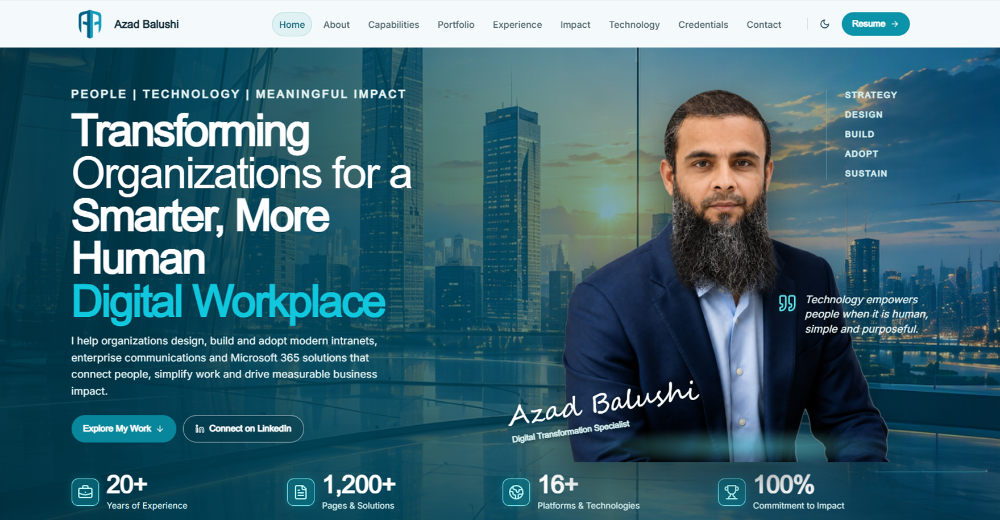

# Azad Balushi — Portfolio Website

> Digital Workplace Transformation specialist showcasing digital workplace transformation, creative design, and enterprise solutions.

---

## Professional Introduction

**Azad Abdul Hameed Balushi** — Web & Digital Communications Specialist — QA Lead at Digital Transformation, SABIC.

Based in Jubail City Center, Al Jubail, Saudi Arabia, Azad Balushi specializes in digital workplace transformation, bringing together technology, design, and communication to create meaningful impact across enterprise environments. This portfolio website presents selected work across multiple creative and technical disciplines.

---

## Live Website

**Website:** [https://azadbalushi.github.io](https://azadbalushi.github.io)

**LinkedIn:** [linkedin.com/in/azadbalushi](https://www.linkedin.com/in/azadbalushi)

---

## Portfolio Overview

The portfolio is a curated collection of professional work presented across 9 categories, with 80 featured projects. Visitors can browse galleries, filter by category, and view full-screen project details with a lightbox viewer.

### Featured Work Categories

1. **3D Artwork** — 7 projects
2. **E Commerce** — 4 projects
3. **Email Communications** — 26 projects
4. **Logo Design** — 1 projects
5. **Photography** — 6 projects
6. **Power BI Dashboard** — 1 projects
7. **SharePoint Development** — 13 projects
8. **UI / UX** — 6 projects
9. **Websites** — 16 projects

---

## Skills Summary

- Digital workplace transformation and employee experience design
- Enterprise intranet and collaboration platform development
- Data visualization and business intelligence dashboards
- Brand identity and visual communication design
- Web design and front-end development
- Digital communications and email marketing
- Photography and creative content production

---

## Technology Stack

- Adobe CC
- Azure
- Copilot
- Figma
- Microsoft 365
- Microsoft Power BI
- Power Platform
- React
- SharePoint
- Teams

---

## Contact Information

| | |
|---|---|
| **Email** | [azadbalushi81@gmail.com](mailto:azadbalushi81@gmail.com) |
| **Phone** | +966548528301 |
| **LinkedIn** | [Azad Balushi](https://www.linkedin.com/in/azadbalushi) |
| **Location** | Jubail City Center, Al Jubail, Saudi Arabia |
| **Resume** | [Download PDF](https://azadbalushi.github.io/azad-balushi-resume.pdf) |

---

## Portfolio Access Instructions

The portfolio gallery is protected behind a simple access gate designed for recruiters, hiring managers, and employers.

1. Navigate to the [portfolio page](https://azadbalushi.github.io/portfolio).
2. You will be redirected to a login screen.
3. Enter the access credentials provided to you.
4. After successful login, the full portfolio gallery becomes available.

**Session-based access:** Your login is valid for the current browser session only. Closing the browser or tab will require signing in again.

---

## About This Repository

This repository contains the static build of the portfolio website, generated for GitHub Pages hosting. The site is built with Next.js and exported as a fully static site.

---

© 2026 Azad Abdul Hameed Balushi. All rights reserved.
